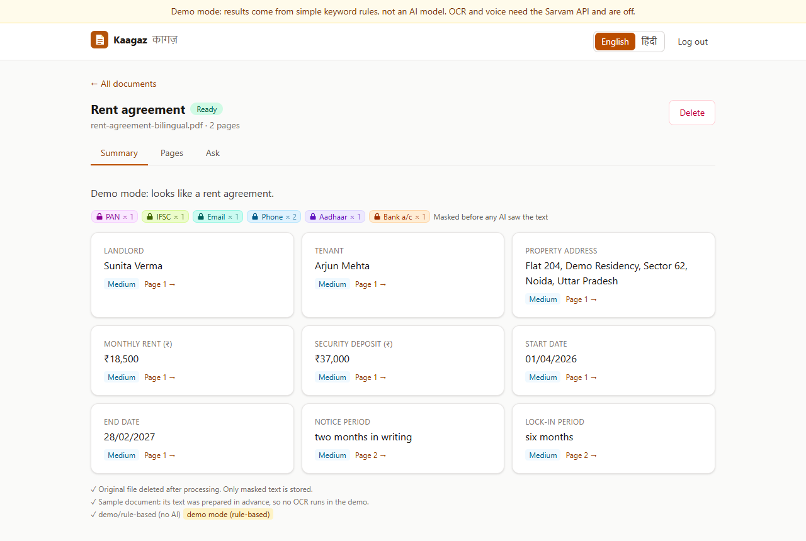
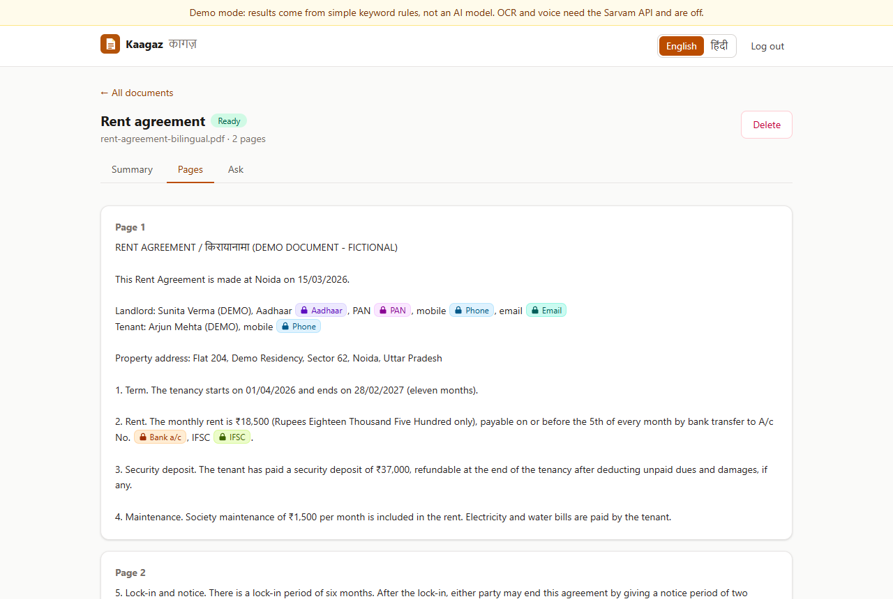
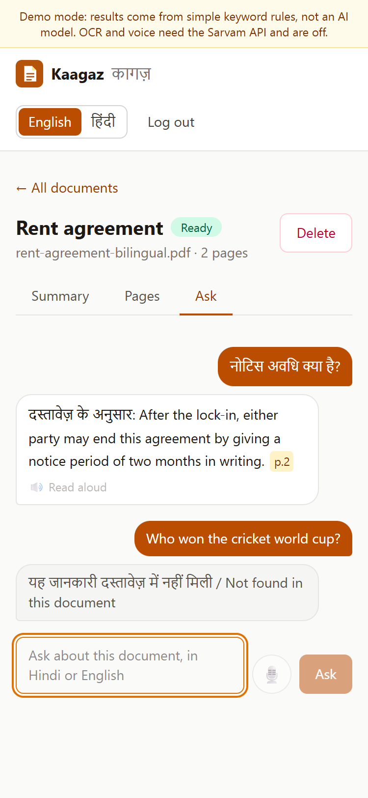
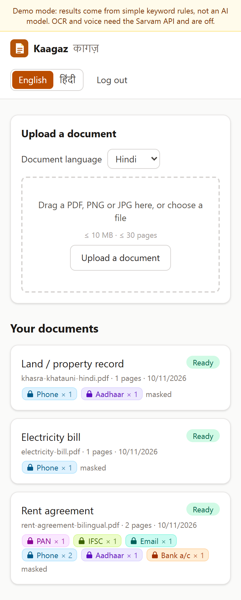
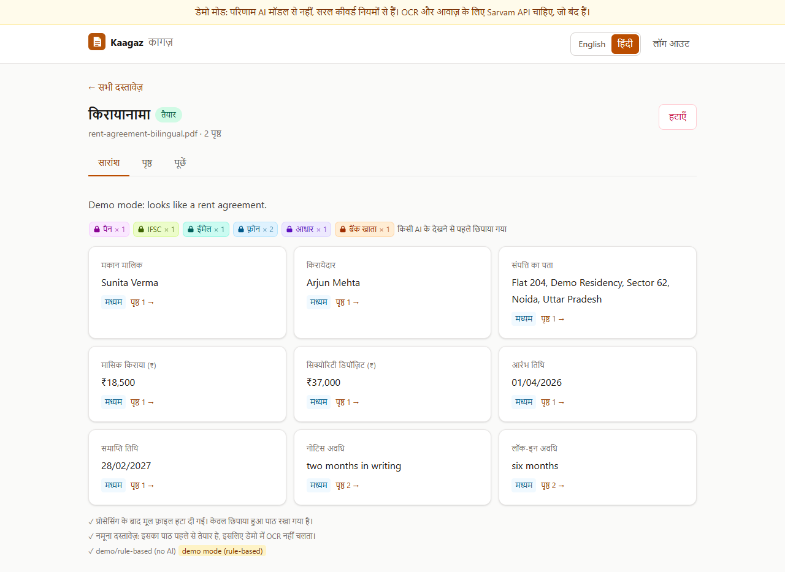
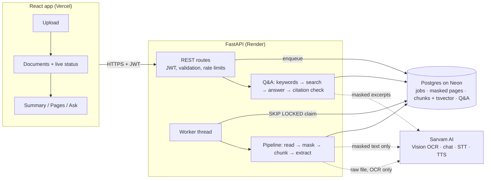

# Kaagaz (कागज़)

[](https://github.com/Navneet-Rishav/kaagaz/actions/workflows/ci.yml)

**A Hindi/English document assistant.** Upload a rent agreement, electricity bill, bank statement or land record. Kaagaz reads it, **masks Aadhaar, PAN, phone, bank and email details before any language model sees the text**, extracts the key fields with the page each came from, and answers questions in Hindi or English with **page citations that are checked in code**.

> **Live demo:** https://kaagaz-pi.vercel.app · API: https://kaagaz-api-l5j7.onrender.com/healthz (free tier: the first request after 15 idle minutes can take up to a minute). Click **"Try the demo"**: you get a private demo account with three sample documents, no sign-up.
> **The public demo runs in demo mode:** a rule-based stand-in replaces the AI model, so no paid API is called. OCR and voice need the Sarvam API and are switched off there (the UI says so). Everything else (upload, queue, masking, retrieval, citation checks, the UI) is the real code path.

| Fields with page links | Masked page text | Q&A with citations (phone) |
|---|---|---|
|  |  |  |

| Documents (phone) | Hindi UI |
|---|---|
|  |  |

## What it does

1. **Upload** a PDF, PNG or JPG (≤ 10 MB, ≤ 30 pages). The type is checked from the file's bytes, duplicates are detected, and the API answers `202` straight away.
2. **Queue:** a worker inside the API claims the job from Postgres with `SELECT … FOR UPDATE SKIP LOCKED`, so jobs are never processed twice and survive restarts.
3. **Read:** the PDF text layer if it is real text; otherwise **Sarvam Vision OCR** (22 Indian languages). Garbled Devanagari text layers, common in browser- and Word-printed PDFs, are detected and sent to OCR too.
4. **Mask** with Microsoft Presidio pattern recognizers: Aadhaar (Verhoeff-checked), PAN, mobile, IFSC, email, and account numbers next to "A/c"/"खाता". Devanagari digits are normalised first. Only masked text and counts are stored; **the original file is deleted**.
5. **Classify and extract** typed fields per document type (rent, deposit, notice period, units, amount due, khasra number…), each with its page and a confidence. Missing values are marked missing, never guessed.
6. **Ask** in Hindi or English, typed or spoken. The question is rewritten into Hindi and English keywords, matched with Postgres full-text search (trigram fallback), and answered only from those excerpts. **Every `[p.N]` must point at a retrieved page or the answer becomes "यह जानकारी दस्तावेज़ में नहीं मिली / Not found in this document".**

## Engineering highlights

**Backend: Python 3.12, FastAPI, SQLAlchemy 2, Alembic, Postgres (Neon)**
- REST API with **JWT auth** (bcrypt), Pydantic v2 validation on every input, one error shape `{ "error": { code, message, details?, request_id } }`, request-ID JSON logs, `/healthz`, CORS limited to the frontend origin.
- **Postgres job queue** with retries and backoff for AI errors, stale-job recovery, and live status (`queued → reading → masking → extracting → ready | failed`) with user-readable failures.
- **Search without an embedding model:** generated `tsvector` (`simple` config, keeps Hindi words intact) + `pg_trgm`, behind a `Retriever` interface so pgvector can be added later.
- **AI behind a `Protocol`:** a Sarvam client (timeouts, retries on 429/5xx, JSON validated with Pydantic and retried once) and an offline demo provider for tests and the demo.
- **Per-user rate limits** on everything that costs money; ownership checks on every document route (another user's document is a 404).
- **Per-visitor demo accounts**, seeded with three synthetic documents and deleted after 24 h, so visitors never see each other's uploads.

**Frontend: React 19, TypeScript, Vite, Tailwind, TanStack Query**
- Drag-and-drop upload, live status polling, Summary / Pages / Ask tabs. Masked values show as coloured chips, citations and field cards link to the page.
- Mic (MediaRecorder → Sarvam STT, code-mixed Hinglish) and read-aloud (Sarvam TTS) buttons, disabled with an explanation in demo mode.
- Full **Hindi/English UI toggle**, responsive from 375 px, loading/empty/error states, accessible labels.

**Tests and CI**
- **122 backend tests** (pytest) against a **real Postgres** (Docker service in CI, bundled `pgserver` locally): Verhoeff, every PII pattern including Devanagari digits and false positives, garbled-text detection, chunk page tracking, the job state machine (retry, give-up, `SKIP LOCKED` with two sessions, stale requeue), auth, upload limits, ownership, rate limits, citation validation and refusal (including a model that cites a page it was not given), voice routes, and the Sarvam client against mocked HTTP.
- **9 frontend tests** (Vitest + Testing Library) plus typecheck, lint and build; an end-to-end run with Playwright produced the screenshots above.
- GitHub Actions: ruff + pytest, frontend checks, Docker build. CI never calls a paid API.
- **Real-API smoke test** (10 Nov 2026, run once by hand, not an eval): Sarvam Vision OCR on the Hindi land-record sample returned clean Devanagari text, masking caught the Devanagari-digit Aadhaar and phone, `sarvam-105b` classified it and extracted khasra number, village, area and owner with page 1, and answered a Hindi and an English question with valid `[p.1]` citations. It also showed the live OCR response format differs from older docs (layout blocks, not one string), and the client was fixed. This is one document, so it says the integration works, not how accurate it is.

## Evals

`backend/evals/` holds a small labelled set: the three demo documents with 19 expected fields (value and page) and 12 questions, 3 of which must be refused. `python -m evals.run` runs them through the real pipeline and Q&A code and reports document-type accuracy, field value + page accuracy, whether answers cite the right page, refusal correctness and p50/p95 latency.

**No results are published yet.** The public demo uses the rule-based stand-in, which was written next to these documents, so its scores would not mean anything; the eval has only been run with it to prove the script works (a test runs it in CI). A real-model run (`AI_PROVIDER=sarvam python -m evals.run`) needs paid API credits; its numbers will go here, labelled as coming from 3 documents and 12 questions.

## Architecture



## API

| Method | Path | Auth | What |
|---|---|---|---|
| POST | `/api/auth/register` · `/login` · `/demo` | public | Get a JWT (`/demo` creates a private demo account) |
| GET | `/api/auth/me` | user | Current user |
| POST | `/api/documents` | user | Upload (multipart `file`, `language` = `hi-IN`/`en-IN`) → 202 |
| GET | `/api/documents` · `/{id}` · `/{id}/pages` · `/{id}/history` | owner | List, fields, masked pages, Q&A history |
| POST | `/api/documents/{id}/ask` | owner, 30/h | `{ question }` → answer, citations, refused |
| DELETE | `/api/documents/{id}` | owner | Delete document and its data |
| POST | `/api/voice/transcribe` · `/speak` | user, 30/h | Speech to text (Hinglish), text to speech |
| GET | `/api/meta` · `/healthz` | public | Demo mode and features · liveness + DB |

## Local setup

Needs Python 3.12 and Node 20+. Postgres from Docker (`docker compose up -d db`) or set `DATABASE_URL` to any Postgres (e.g. Neon).

```bash
cd backend && python -m venv .venv && .venv/Scripts/pip install -r requirements-dev.txt   # macOS/Linux: .venv/bin/pip
cp .env.example .env   # set JWT_SECRET; AI_PROVIDER=demo needs no API key
alembic upgrade head && uvicorn --factory app.main:create_app --reload
cd ../frontend && npm install && npm run dev   # http://localhost:5173
```

Tests: `cd backend && pytest` (starts a throwaway Postgres automatically if `TEST_DATABASE_URL` is not set) and `cd frontend && npm test`.

## Design decisions and known limitations

Full reasoning, with alternatives, is in [docs/DECISIONS.md](docs/DECISIONS.md). In short:

- **OCR sees the raw document; the language model never does.** Masking happens after OCR and before anything is stored or sent to the chat model.
- **Names and addresses are not masked:** that needs an NER model, which does not fit free-tier RAM. Only pattern-based identifiers are masked.
- **No embeddings:** keyword search in two languages plus trigram fallback. It can miss answers phrased very differently from the document.
- **The public demo uses rule-based stand-ins, not AI**, and its sample documents use prepared text instead of OCR. It shows the product flow, not model quality. No accuracy numbers are reported from it.
- **Deploys:** pushes to `main` deploy the API on Render and the app on Vercel once CI passes.
- **Render free tier sleeps** after 15 idle minutes; the first request can take up to a minute.
- Rate limits are in memory (per process).

## License

MIT. All names, numbers and places in the sample documents are fictional.
